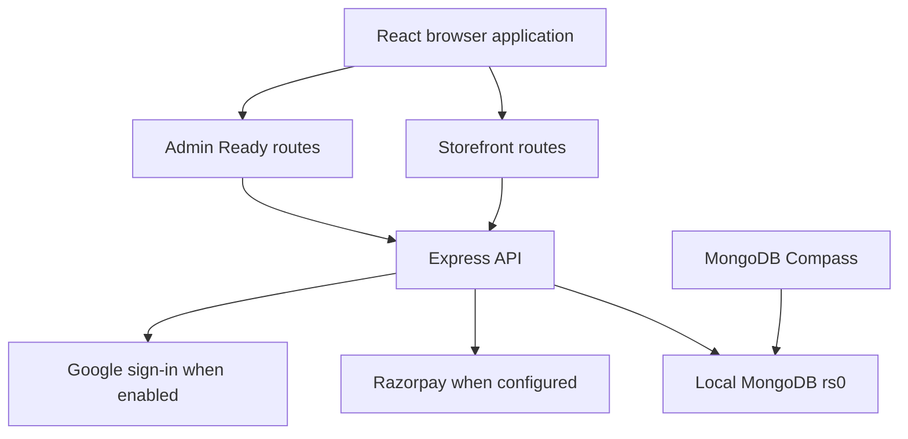
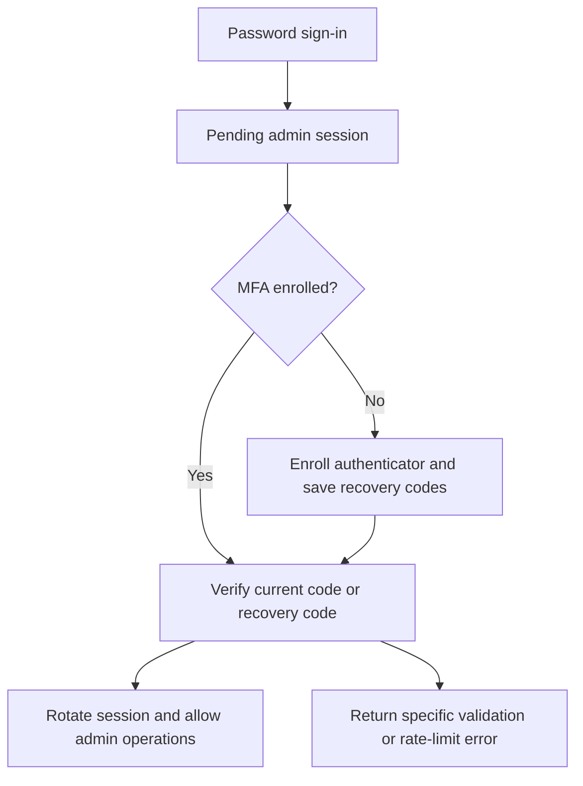

# AURELIA architecture

Source: cleaned `InternProject(2).zip`, reviewed 3 October 2026. This describes the supplied implementation, not a proposed redesign. Start and environment instructions are in the root README.

## System structure

A single React application contains the storefront and admin UI. One Express API owns authentication, catalog, content, orders and administration. MongoDB stores application records and sessions. There are no separate microservices or job queues.

In development Vite serves port 5173 and proxies `/api` to Express on port 5000. The Windows MongoDB service listens on 27017. Compass is a database client, not the server. A single-member replica set enables the transactions used by this application; Docker is not required.

## Entry points and ownership

| Path | Responsibility |
| --- | --- |
| `package.json` | Root start/build/setup/test commands |
| `admin-tools/start.mjs` | Runs backend watch process and Vite; handles shutdown |
| `backend/server.js` | Standard entry point importing the canonical Admin Ready server |
| `backend/app.js` | Compatibility export of the canonical application factory |
| `backend/admin-ready/server.js` | Connect database, prepare empty database, optional new admin, payment reconciliation, listen/shutdown |
| `backend/admin-ready/app.js` | Express middleware, route mounting and production static UI |
| `backend/admin-ready/database.js` | Replica-set check and non-destructive empty-database initialization |
| `backend/config/` | Environment validation and runtime settings |
| `backend/routes/` | Shared authentication, storefront, catalog, admin and commerce endpoints |
| `backend/admin-ready/routes.js` | Current admin overview, discount drafts, storefront draft/publish and export |
| `backend/admin-ready/security.js` | Admin MFA enrollment, verification, recovery and password changes |
| `backend/models/` | Mongoose user, product and domain schemas |
| `backend/db/` | Collection validators, indexes and database maintenance implementation |
| `backend/services/` | Catalog, commerce, payment and validation logic |
| `backend/scripts/` | Explicit diagnostics, admin creation, migration and seeding commands |
| `frontend/src/main.jsx` | React root |
| `frontend/src/App.jsx` | Providers, public routes and `/admin/*` routing |
| `frontend/src/context/` | Authentication, store, cart and wishlist state (see source inventory for exact filenames) |
| `frontend/src/services/api.js` | Credentialed Axios client and CSRF handling |
| `frontend/src/admin-ready/ReadyAdmin.jsx` | Admin access gate, navigation and dashboard |
| `frontend/src/admin-ready/AdminAccess.jsx` | Admin login and MFA screens |
| `frontend/src/admin-ready/ExistingEditors.jsx` | Shared catalog/content/settings editors still used by current admin |
| `frontend/src/admin-ready/Management.jsx` | Additional management screens |
| `frontend/src/admin-ready/studioApi.js` | Admin API error handling; preserves actual server errors |
| `frontend/src/admin-ready/studio.css` | Existing admin styling |
| `frontend/vite.config.js` | Shared development proxy and `dist-admin` build output |
| `frontend/vite.admin.config.mjs` | Compatibility re-export of the same Vite config |

The old `admin-studio` frontend and legacy `pages/Admin.jsx` were removed. Backend `adminStudioRoutes.js` and `adminRoutes.js` remain because the current UI still calls them. `ExistingEditors.jsx`, including `ContentSettings`, also remains essential.

## Frontend navigation and state

Public pages include home, shop, category, product, collections, blog, content pages, contact, cart, wishlist, checkout, orders, profile, login and signup. The forgot-password page does not provide a configured email reset service. Admin navigation includes dashboard, products, categories, inventory, orders, customers, discounts, storefront, reviews and settings.

Provider composition is Helmet → authentication → store → cart → wishlist → router. Public content is loaded from the API; catalog/order data is not replaced by hard-coded dashboard samples. Dashboard aggregate cards and tables remain, while a revenue-overview graph is absent. Existing visual styling was retained.

Admin entry checks session state, then admin role, then completed MFA before exposing protected screens. Hiding a screen is not the security boundary: server middleware independently validates access.

## API map

| Prefix | Responsibility |
| --- | --- |
| `/api/health` | API health endpoint |
| `/api/auth` | Session, password login, logout and authentication operations |
| `/api/v1/auth`, `/api/v1` | Existing authentication compatibility aliases |
| `/api/products`, `/api/v1/products` | Public catalog |
| Cart/wishlist routes and their existing v1 aliases | Customer saved shopping state |
| `/api/content` | Published storefront, pages, blog, collections, contact, newsletter and reviews |
| `/api/orders` | Checkout/order/payment operations |
| `/api/admin` | Shared catalog/content/customer/order administration |
| `/api/admin/studio` | Metrics, catalog lookup, inventory and management operations used by current UI |
| `/api/admin-ready` | Current dashboard, readiness, draft/publish, discount drafts and CSV export |
| `/api/admin-ready/security` | MFA setup/verify/recover and password changes |
| `/api/payments/razorpay/webhook` | Raw-body signed Razorpay notifications |

Specific HTTP methods and request schemas remain authoritative in the route files. These prefixes are not independent services.

## Authentication and session flow

Sessions are persisted through connect-mongo. The `aurelia.sid` cookie is HTTP-only, same-site lax and secure in production. Admin session duration is 30 minutes with rolling behavior; customer remember-me behavior is separate. CSRF tokens protect mutations. The frontend obtains tokens and retries the specific invalid-CSRF response once.

Admin role, account status, session version and MFA state are checked on the server. Password changes require the current password and completed MFA and revoke existing sessions by changing session version. MFA secrets are encrypted using the configured encryption key; recovery codes are hashed and single-use. Pending enrollment expires after ten minutes. MFA endpoints retain their existing 20 requests per 15-minute limit.

Keep `SESSION_SECRET` and `MFA_ENCRYPTION_KEY` unchanged for existing installations. Blank Google credentials are acceptable with Google authentication disabled and do not prevent authenticator MFA. The cleanup improves error reporting; it does not bypass MFA or guarantee that a user's currently enrolled code is valid.

## Data model

Collection definitions and indexes live in `backend/db/collectionDefinitions.js`; Mongoose schemas are in `backend/models`. Related records generally use MongoDB ObjectIds.

| Domain | Collections / data |
| --- | --- |
| Accounts | `users`, `auth_tokens`; embedded addresses, role, status, session version and MFA state |
| Catalog | `products`, `product_variants`, `categories`, `product_collections` |
| Media | `media` schema; current editors primarily work with image URLs |
| Content | `homepages`, `homepage_drafts`, `pages`, `blog_posts`, `site_settings` |
| Shopping state | `carts`, `wishlists` |
| Orders and payments | `orders`, `payments`, `payment_events` |
| Inventory | `inventory_reservations`, `inventory_movements` plus variant stock/reserved counts |
| Promotions | `coupons`, `coupon_redemptions` |
| Engagement | `reviews`, `subscribers`, `contactmessages` |
| Operations | `audit_logs`; session store and maintenance metadata |

Products own display/catalog content. Product variants own purchasable SKU, integer price and stock. Orders snapshot purchased names, quantities and prices so later catalog edits do not rewrite past orders. Payment and fulfillment status are separate. Commerce totals are integer INR paise and converted for display.

Validators enforce required fields and types. Unique indexes protect identities and idempotency; expiry indexes apply where configured. Startup avoids automatic Mongoose index/schema rewriting. If application records already exist, `prepareDatabase` leaves existing records, validators and indexes in place. On an empty application database it prepares collections and indexes without seeding sample content. Deliberate migrations remain separate commands.

The ZIP contains source code, not the contents of your local MongoDB database. Existing local data and a former Docker volume are separate stores. Changing the URI can therefore make content appear missing without deleting it.

## Commerce and content flows

Checkout validates published/active catalog data and prices on the server. Transactions coordinate order, inventory reservation and payment state. Idempotency prevents duplicate processing. Online payment uses provider order creation, signature checks, confirmation and signed webhooks; reconciliation handles outstanding payment state. Reservation release/commit is part of commerce processing. The server's reconciliation timer is an in-process task, not a durable external worker.

Razorpay remains optional and requires valid credentials. Missing credentials do not simulate payment success. COD is a separate configuration option. These external payment paths were not live-tested during cleanup.

Storefront editing keeps a draft separate from published homepage content. Publishing is an explicit action. Shared catalog and content editors continue to use their existing endpoints. Discount management currently produces inactive drafts; checkout coupon application is not implemented. Do not describe it as a working promotional pricing engine.

## Configuration and local lifecycle

`backend/.env` supplies database URI, session/MFA keys, port, client origin and optional integrations. In development an explicit `MONGO_URI` overrides `MONGO_DEV_URI`. Tests must use a separate test database. Vite proxies local requests to avoid requiring a separate browser API origin.

Daily workflow: MongoDB Windows service running → `npm run dev` in project root → open `http://localhost:5173/admin`. Setup, admin creation, migration and seeding are not daily startup steps. `npm run build` produces `frontend/dist-admin`; the retained production helper can serve built assets, but production deployment is outside this task.

## Known boundaries and verification

- Authenticator MFA and rate limiting remain enabled.
- No configured email password-reset delivery, complete media upload pipeline or checkout coupon application is added.
- Existing payment and Google integrations remain optional; neither was tested against external accounts.
- Local source checks, frontend build and 17 isolated admin tests passed. Real Windows service, database records and browser login require verification on the user's laptop.
- See `TESTING.md` for exact checks and `CHANGES.md` for replacement instructions.

## Complete source inventory

Paths below are relative to the project root; dependencies, generated builds, secrets and Git history are excluded.

- `.env.example`
- `.gitignore`
- `ADMIN_READY_README.md`
- `ADMIN_READY_VALIDATION.md`
- `README.md`
- `START_ADMIN.cmd`
- `admin-tools/build.mjs`
- `admin-tools/install.mjs`
- `admin-tools/production.mjs`
- `admin-tools/setup.mjs`
- `admin-tools/start.mjs`
- `backend/.env.example`
- `backend/admin-ready/app.js`
- `backend/admin-ready/database.js`
- `backend/admin-ready/routes.js`
- `backend/admin-ready/security.js`
- `backend/admin-ready/server.js`
- `backend/admin-ready/tests/database.test.js`
- `backend/admin-ready/tests/management.test.js`
- `backend/admin-ready/tests/security.test.js`
- `backend/admin-ready/tests/static.test.js`
- `backend/app.js`
- `backend/config/env.js`
- `backend/config/passport.js`
- `backend/data/storefront-seed.json`
- `backend/db/collectionDefinitions.js`
- `backend/db/migrate.js`
- `backend/middleware/authMiddleware.js`
- `backend/middleware/csrfMiddleware.js`
- `backend/middleware/errorMiddleware.js`
- `backend/models/Product.js`
- `backend/models/User.js`
- `backend/models/domainModels.js`
- `backend/package-lock.json`
- `backend/package.json`
- `backend/routes/adminRoutes.js`
- `backend/routes/adminStudioRoutes.js`
- `backend/routes/authRoutes.js`
- `backend/routes/cartRoutes.js`
- `backend/routes/contentRoutes.js`
- `backend/routes/orderRoutes.js`
- `backend/routes/productRoutes.js`
- `backend/routes/webhookRoutes.js`
- `backend/routes/wishlistRoutes.js`
- `backend/scripts/create-admin.js`
- `backend/scripts/diagnose-database.js`
- `backend/scripts/migrate-database.js`
- `backend/scripts/run-db-tests.js`
- `backend/scripts/seed-development.js`
- `backend/scripts/seed-storefront.js`
- `backend/scripts/setup-env.js`
- `backend/scripts/setup-mongo-access.js`
- `backend/scripts/verify-database.js`
- `backend/server.js`
- `backend/services/adminStudioMetrics.js`
- `backend/services/catalog.js`
- `backend/services/commerce.js`
- `backend/services/razorpay.js`
- `backend/services/validation.js`
- `backend/tests/commerce.test.js`
- `backend/tests/database.test.js`
- `backend/tests/payments.test.js`
- `backend/tests/reconciliation.test.js`
- `backend/tests/security.test.js`
- `docs/ARCHITECTURE.md`
- `docs/CHANGES.md`
- `docs/CONTEXT_README.md`
- `docs/TESTING.md`
- `frontend/.gitignore`
- `frontend/.oxlintrc.json`
- `frontend/README.md`
- `frontend/index.html`
- `frontend/package-lock.json`
- `frontend/package.json`
- `frontend/public/favicon.svg`
- `frontend/public/icons.svg`
- `frontend/public/robots.txt`
- `frontend/public/sitemap.xml`
- `frontend/src/App.css`
- `frontend/src/App.jsx`
- `frontend/src/admin-ready/AdminAccess.jsx`
- `frontend/src/admin-ready/ExistingEditors.jsx`
- `frontend/src/admin-ready/Management.jsx`
- `frontend/src/admin-ready/ReadyAdmin.jsx`
- `frontend/src/admin-ready/studio.css`
- `frontend/src/admin-ready/studioApi.js`
- `frontend/src/admin.css`
- `frontend/src/assets/hero.png`
- `frontend/src/auth-overrides.css`
- `frontend/src/commerce.css`
- `frontend/src/components/CartItem.jsx`
- `frontend/src/components/Layout.jsx`
- `frontend/src/components/ProductCard.jsx`
- `frontend/src/components/ProductReviews.jsx`
- `frontend/src/components/ScrollToTop.jsx`
- `frontend/src/context/AuthContext.jsx`
- `frontend/src/context/CartContext.jsx`
- `frontend/src/context/StoreContext.jsx`
- `frontend/src/context/WishlistContext.jsx`
- `frontend/src/context/useSavedItems.js`
- `frontend/src/data/blogs.js`
- `frontend/src/data/products.js`
- `frontend/src/hooks/useApi.js`
- `frontend/src/index.css`
- `frontend/src/main.jsx`
- `frontend/src/pages/AuthPages.jsx`
- `frontend/src/pages/BlogPages.jsx`
- `frontend/src/pages/CategoryProducts.jsx`
- `frontend/src/pages/Checkout.jsx`
- `frontend/src/pages/ContentPages.jsx`
- `frontend/src/pages/ForgotPassword.jsx`
- `frontend/src/pages/Home.jsx`
- `frontend/src/pages/Orders.jsx`
- `frontend/src/pages/ProductDetails.jsx`
- `frontend/src/pages/Profile.jsx`
- `frontend/src/pages/ShopPages.jsx`
- `frontend/src/pages/SimplePages.jsx`
- `frontend/src/profile.css`
- `frontend/src/responsive-home.css`
- `frontend/src/services/api.js`
- `frontend/src/services/format.js`
- `frontend/src/services/payment.js`
- `frontend/vite.admin.config.mjs`
- `frontend/vite.config.js`
- `package-lock.json`
- `package.json`
